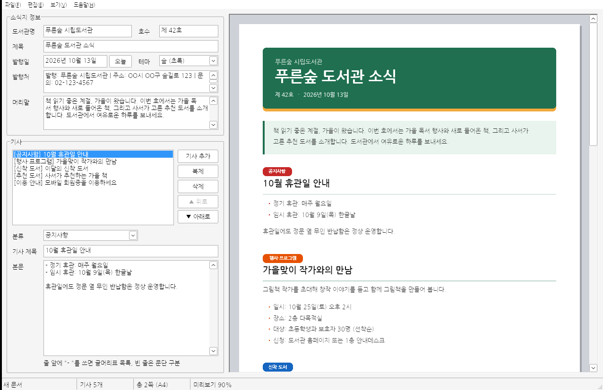

# 도서관 소식지 편집기 (Library Newsletter Editor)

Visual C++(Win32 API)로 만든 **도서관 뉴스레터(소식지) 편집기**입니다.
왼쪽 양식에 소식지 정보와 기사를 입력하면 오른쪽에 A4 쪽 모양의 미리보기가 실시간으로 바뀌고,
그대로 인쇄하거나 HTML(이메일·홈페이지 게시용)로 내보낼 수 있습니다.



## 주요 기능

- **소식지 정보**: 도서관명, 제목, 호수, 발행일(`오늘` 버튼), 발행처·연락처, 머리말
- **기사 관리**: 추가 / 복제 / 삭제 / 위·아래로 순서 바꾸기
  - 분류: 공지사항, 신착 도서, 추천 도서, 행사·프로그램, 이용 안내, 기타 (직접 입력도 가능)
  - 분류마다 색이 다른 꼬리표로 표시
- **본문 서식**: 줄 앞에 `- `(또는 `* `, `• `)를 쓰면 글머리표 목록, 빈 줄은 문단 구분
- **실시간 미리보기**: A4 쪽 나눔, 쪽 번호 바닥글, 확대/축소(`Ctrl`+휠, `Ctrl`+`+`/`-`/`0`)
- **색상 테마 5종**: 숲(초록), 바다(파랑), 노을(주황), 단풍(자주), 흑백(인쇄용)
- **인쇄**: 미리보기와 같은 배치로 인쇄, 쪽 범위 지정 가능
- **HTML 내보내기**: CSS가 포함된 단일 HTML 파일 생성 후 브라우저로 열기
- **저장/열기**: `.lnews` 파일(UTF-8 텍스트), 끌어다 놓기·명령줄 인수로 열기,
  저장하지 않은 변경 사항 확인

## 빌드

### Visual Studio (권장)

요구 사항: Visual Studio 2022, **"C++를 사용한 데스크톱 개발"** 워크로드

1. `NewsletterEditor.sln`을 엽니다.
2. 구성(`Debug`/`Release`)과 플랫폼(`x64`/`x86`)을 고르고 **F5**로 실행합니다.
3. 실행 파일은 `bin\<플랫폼>\<구성>\NewsletterEditor.exe`에 만들어집니다.

솔루션에는 두 프로젝트가 있습니다.

| 프로젝트 | 내용 |
|---|---|
| `NewsletterEditor` | 편집기 프로그램 (Windows GUI) |
| `NewsletterTests` | 데이터 모델·파일 형식·HTML 내보내기 단위 테스트 (콘솔) |

> Visual Studio 2019를 쓰는 경우 프로젝트 속성에서 플랫폼 도구 집합을 `v142`로 바꾸세요.

### CMake

```bat
cmake -S . -B build
cmake --build build --config Release
ctest --test-dir build -C Release
```

MinGW-w64로도 빌드됩니다. Windows가 아닌 환경에서는 단위 테스트(`NewsletterTests`)만 빌드됩니다.

## 사용 방법

1. 처음 실행하면 예제 소식지가 열립니다. 새로 만들려면 `파일 > 새 소식지`(`Ctrl+N`).
2. 위쪽 **소식지 정보**에 도서관명·제목·호수 등을 입력합니다.
3. **기사** 목록에서 기사를 고르고 분류·제목·본문을 고칩니다. 새 기사는 `기사 추가`(`Ctrl+Shift+N`).
4. 오른쪽 미리보기로 결과를 확인하고 `파일 > 인쇄`(`Ctrl+P`) 또는
   `파일 > HTML로 내보내기`(`Ctrl+E`)로 배포합니다.
5. `Ctrl+S`로 `.lnews` 파일에 저장해 두면 다음 호를 만들 때 복사해서 고쳐 쓸 수 있습니다.

### 단축키

| 키 | 기능 |
|---|---|
| `Ctrl+N` / `Ctrl+O` / `Ctrl+S` / `Ctrl+Shift+S` | 새로 만들기 / 열기 / 저장 / 다른 이름으로 저장 |
| `Ctrl+E` | HTML로 내보내기 |
| `Ctrl+P` | 인쇄 |
| `Ctrl+Shift+N` / `Ctrl+Shift+D` | 기사 추가 / 복제 |
| `Ctrl+Shift+↑` / `Ctrl+Shift+↓` | 기사 순서 위로 / 아래로 |
| `Ctrl++` / `Ctrl+-` / `Ctrl+0` | 미리보기 확대 / 축소 / 너비에 맞춤 |

## 구조

```
NewsletterEditor/
├── NewsletterEditor.sln        # Visual Studio 솔루션
├── NewsletterEditor.vcxproj    # 편집기 프로젝트
├── NewsletterTests.vcxproj     # 단위 테스트 프로젝트
├── CMakeLists.txt
├── src/
│   ├── main.cpp                # wWinMain, 메시지 루프
│   ├── MainWindow.*            # 주 창: 입력 양식, 메뉴, 파일·인쇄 처리
│   ├── PreviewWindow.*         # 실시간 미리보기 컨트롤 (스크롤·확대, 이중 버퍼링)
│   ├── Renderer.*              # GDI 배치·쪽 나눔·그리기 (미리보기와 인쇄가 공용)
│   ├── Newsletter.*            # 데이터 모델, 테마, .lnews 저장 형식, UTF-8 변환
│   ├── HtmlExport.*            # HTML 내보내기
│   └── resource.h
├── res/                        # 아이콘, 매니페스트(공용 컨트롤 6.0, DPI 인식), .rc
├── tests/NewsletterTests.cpp
└── tools/make_icon.py          # 아이콘 생성 스크립트 (Python + Pillow)
```

### 설계 메모

- **미리보기 = 인쇄**: `Renderer`는 쪽 하나를 800×1131 논리 단위(A4 비율)로 보고, 화면 배율과 상관없이
  고정된 측정용 DC에서 줄바꿈·쪽 나눔을 계산합니다. 미리보기와 프린터는 `SetMapMode(MM_ANISOTROPIC)`로
  배율만 바꿔 같은 결과를 그리므로 쪽 수와 줄바꿈이 일치합니다.
- **줄바꿈**: 한국어 어절(공백) 단위로 나누고, 한 어절이 줄보다 길면 글자 단위로 자릅니다.
  기사 제목은 본문 첫 줄과 같은 쪽에 오도록 묶습니다.
- **데이터 모델은 Windows API에 의존하지 않아** 다른 플랫폼에서도 단위 테스트할 수 있습니다.

### `.lnews` 파일 형식

UTF-8 텍스트이며 `키=값` 형식입니다. 값 안의 줄바꿈은 `\n`, 역슬래시는 `\\`로 저장합니다.

```ini
[newsletter]
format=1
library=푸른숲 시립도서관
title=푸른숲 도서관 소식
issue=제 42호
date=2026년 10월 13일
publisher=발행: 푸른숲 시립도서관\n문의: 02-123-4567
greeting=책 읽기 좋은 계절, 가을이 왔습니다.
theme=0

[article]
category=공지사항
title=10월 휴관일 안내
body=- 정기 휴관: 매주 월요일\n- 임시 휴관: 10월 9일(목) 한글날
```

## 요구 사항

- Windows 7 이상 (Windows 10/11 권장)
- 글꼴: 맑은 고딕 (Windows 기본 글꼴)
